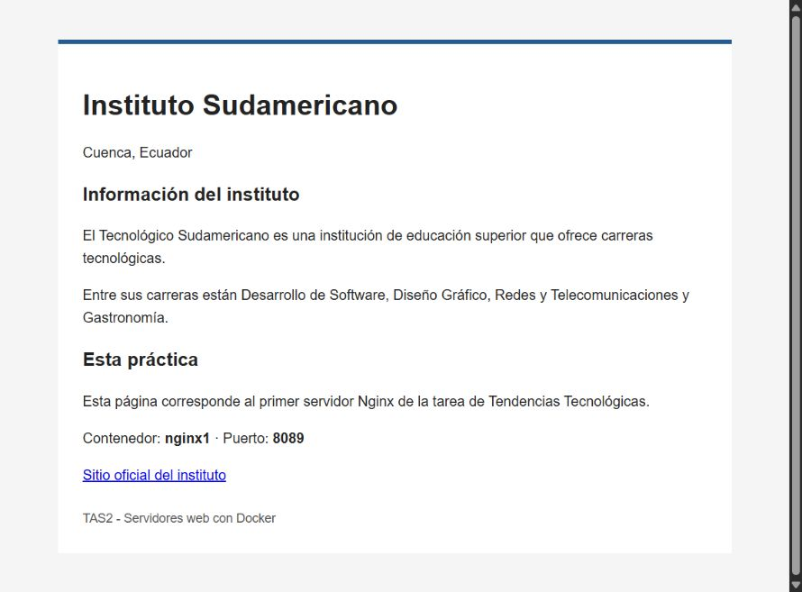
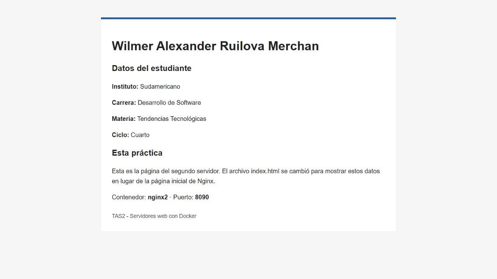

# TAS2 - Dos servidores web con Nginx

Nombre: Wilmer Alexander Ruilova Merchan
Materia: Tendencias Tecnológicas
Fecha: 13 de octubre de 2026

## 1. Título
Crear dos servidores Nginx y cambiar el contenido de sus páginas.

## 2. Tiempo de duración
Aproximadamente 8 minutos para crear los contenedores, editar las páginas y comprobar que funcionen. Este tiempo corresponde a la sesión de práctica; la grabación del audio se realiza después.

## 3. Fundamentos
Docker permite ejecutar aplicaciones dentro de contenedores. Una imagen contiene los archivos y las herramientas que necesita una aplicación para funcionar. El contenedor es una instancia creada a partir de esa imagen. En esta práctica se usó la imagen oficial de Nginx dos veces, pero cada contenedor quedó con una página distinta.

Nginx es un servidor web. Su trabajo en este ejercicio es recibir la petición del navegador y devolver el archivo HTML. La imagen trae una página inicial que dice Welcome to nginx. Al cambiar index.html, el navegador muestra el contenido nuevo en lugar de esa página. El archivo se encuentra en /usr/share/nginx/html/index.html dentro de cada contenedor.

Los puertos permiten acceder a los dos servidores desde el mismo computador. Ambos contenedores usan el puerto 80 por dentro. En el primero se publicó el puerto 8089 y en el segundo el 8090. Por eso se puede abrir localhost:8089 para ver la información del instituto y localhost:8090 para ver los datos del estudiante. Si se intenta usar el mismo puerto del anfitrión para los dos servidores al mismo tiempo, se produce un conflicto.

El comando docker run crea el contenedor y lo inicia. La opción -d lo deja funcionando en segundo plano. Con --name se le asigna un nombre para reconocerlo y con -p se conecta un puerto del computador con uno del contenedor. Los nombres nginx1 y nginx2 ayudan a saber sobre cuál servidor se está trabajando.

Para cambiar la página se utilizó docker cp. Primero se copió el archivo desde el contenedor hacia la carpeta de trabajo. Luego se editó el HTML y se volvió a copiar al contenedor. Este proceso se repitió con el segundo servidor. Cada contenedor tiene su propia copia del archivo, así que modificar la página de nginx1 no cambia la de nginx2.

También hay una diferencia entre detener y eliminar un contenedor. Si se detiene, los cambios de esta práctica permanecen y se puede iniciar de nuevo con docker start. Si se elimina y se crea otro desde la imagen original, esa página personalizada no se recupera sola. Por eso conviene guardar index1.html e index2.html en el computador y en el repositorio.



Figura 1. Página del instituto. Este contenido se obtiene desde nginx1, por el puerto 8089.

## 4. Conocimientos previos
- Crear archivos y carpetas en Linux.
- Usar comandos desde la terminal.
- Conocer la estructura básica de una página HTML.
- Diferenciar el puerto del computador y el puerto del contenedor.

## 5. Objetivos a alcanzar
- Crear los contenedores nginx1 y nginx2.
- Mostrar una página institucional en el puerto 8089.
- Mostrar los datos del estudiante en el puerto 8090.
- Copiar y editar los archivos HTML de ambos servidores.
- Comprobar que las páginas abren desde el navegador.

## 6. Equipo necesario
- Computador con Windows y Ubuntu 24.04.4 LTS en WSL 2.
- Docker Engine 29.1.3, instalado dentro de Ubuntu.
- Imagen oficial nginx:latest. En esta sesión corresponde a Nginx 1.31.6.
- Editor Vi, navegador y cuenta de GitHub.
- Grabadora para preparar el audio de la entrega.

## 7. Material de apoyo
- Instrucciones de TAS2 en EVA.
- Video S2-servidor nginx con contedores.mp4 proporcionado para la práctica. Se revisaron escenas de la creación del servidor y la copia del HTML.
- Plantilla del informe: https://github.com/maguaman2/informe-tendencias
- Documentación de Docker y página oficial del Instituto Sudamericano.

## 8. Procedimiento
La práctica se realizó en Ubuntu WSL. Los archivos quedaron en la carpeta Tendencias_Tecnologicas_T2, dentro de 02 - Estudios del escritorio.

### Paso 1. Crear los dos contenedores
```bash
docker run -d --name nginx1 -p 8089:80 nginx
docker run -d --name nginx2 -p 8090:80 nginx
```
Los contenedores tienen nombres y puertos distintos. La imagen nginx se descargó al crear el primero porque nginx:latest todavía no estaba en el equipo.

### Paso 2. Copiar las páginas al computador
```bash
docker cp nginx1:/usr/share/nginx/html/index.html ./index1.html
docker cp nginx2:/usr/share/nginx/html/index.html ./index2.html
```
Se guardó también una copia de las páginas originales antes de editarlas.

### Paso 3. Editar index1.html
El archivo se editó con Vi en modo Ex. Se guardó el HTML con el nombre del Instituto Sudamericano, su ubicación y algunas de sus carreras. El contenido que quedó guardado se puede revisar en [index1.html](index1.html).

### Paso 4. Copiar la página institucional a nginx1
```bash
docker cp index1.html nginx1:/usr/share/nginx/html/index.html
```
Después se abrió http://localhost:8089/ para revisar el cambio. El resultado se ve en la figura 1.

### Paso 5. Repetir el proceso con nginx2
En index2.html se colocaron el nombre del estudiante, el instituto, la carrera, la materia y el ciclo. Se editó con el mismo editor y se copió al segundo contenedor:
```bash
docker cp index2.html nginx2:/usr/share/nginx/html/index.html
```
El archivo completo está en [index2.html](index2.html). La página se abrió en http://localhost:8090/.



Figura 2. Página personal del estudiante en nginx2, por el puerto 8090.

### Paso 6. Comprobar los servidores
```bash
docker ps --filter name=nginx1 --filter name=nginx2
docker exec nginx1 nginx -t
docker exec nginx2 nginx -t
```
Los dos contenedores aparecieron activos y la configuración de Nginx pasó las comprobaciones. También se comparó el HTML guardado en el computador con el HTML de cada contenedor y coincidieron. Ambos servidores devolvieron HTTP 200.

Ubuntu WSL se cerró entre algunas comprobaciones y los contenedores quedaron detenidos. Se volvieron a iniciar y se mantuvo la sesión de Ubuntu abierta:
```bash
docker start nginx1 nginx2
```
La salida de la comprobación final está en [verificacion.txt](verificacion.txt).

## 9. Resultados esperados
Al terminar quedaron dos servidores con contenido diferente:

| Contenedor | Puerto | Contenido |
| --- | --- | --- |
| nginx1 | 8089 | Información del Instituto Sudamericano |
| nginx2 | 8090 | Datos de Wilmer Alexander Ruilova Merchan |

Las dos páginas abren desde Windows y muestran el contenido editado. No fue necesario instalar Docker Desktop, porque Docker ya funcionaba dentro de Ubuntu WSL. Los archivos HTML y las capturas quedaron guardados junto al informe.

Las capturas de las figuras 1 y 2 muestran las páginas finales. Las direcciones localhost funcionan en este computador mientras Ubuntu y los contenedores estén activos; no son enlaces públicos para el docente.

## 10. Bibliografía
Docker, Inc. (s. f.). *docker container run*. Docker Docs. https://docs.docker.com/reference/cli/docker/container/run/

Docker, Inc. (s. f.). *docker container cp*. Docker Docs. https://docs.docker.com/reference/cli/docker/container/cp/

Docker Official Images. (s. f.). *nginx*. Docker Hub. https://hub.docker.com/_/nginx

Instituto Sudamericano. (s. f.). *Instituto Sudamericano*. https://sudamericano.edu.ec/

Instituto Sudamericano. (2026). *TAS2 - Contenedores servidor web* [Actividad de clase]. EVA. https://eva.sudamericano.edu.ec/mod/assign/view.php?id=36884

maguaman2. (s. f.). *informe-tendencias* [Plantilla de informe]. GitHub. https://github.com/maguaman2/informe-tendencias
